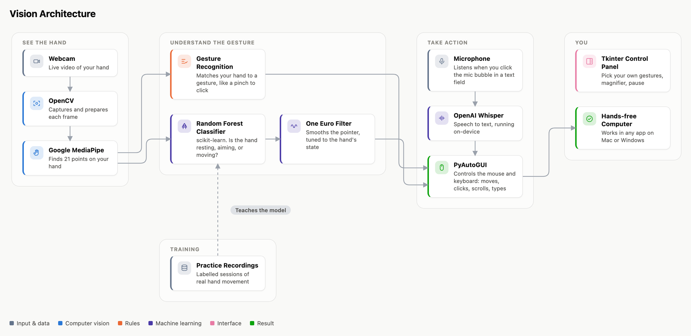

# vision

Control your computer with hand gestures from a webcam. Point to move the cursor,
pinch to click and drag, and use other gestures to scroll, press Enter or
Backspace, move windows, and dictate text. Every gesture can be remapped, or
replaced with a pose you record, to suit your mobility.

A gesture pane on the right of the screen shows each action and its gesture; click
a row to change it. Toggle gesture control from the pane, the tray icon, or
**Ctrl+Alt+G**.

## How it works



The diagram's source is [docs/architecture.html](docs/architecture.html).

## Setup

Requires Python 3.10 or newer and a webcam.

macOS:

```sh
brew install portaudio            # needed by PyAudio for dictation
python3 -m venv .venv
.venv/bin/pip install -r requirements.txt
.venv/bin/python main.py
```

Windows:

```
py -3 -m venv .venv
.venv\Scripts\pip install -r requirements.txt
.venv\Scripts\python main.py
```

The hand-tracking model downloads into `assets/` on first run. On macOS, allow
camera, accessibility, and microphone access when prompted. Options: `--camera N`
to pick a webcam, `--no-tray` to hide the tray icon.

Run the tests with `python -m pytest tests cursor_stabilization`.
Cursor smoothing is described in [cursor_stabilization](cursor_stabilization/README.md).
